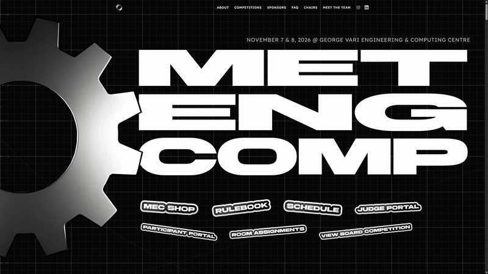

# Metropolitan Engineering Competition (MEC) Website




Marketing site for the Metropolitan Engineering Competition — a two-day engineering event with nine competition streams. Built as a static frontend for easy deployment and frequent content updates.

## Technology stack

- React + TypeScript
- Vite
- Tailwind CSS v4 (`@tailwindcss/vite`)
- Motion for React (animations)
- Lucide React (icons)

## Getting started

```bash
npm install
npm run dev
```

Open the local URL printed by Vite (usually `http://localhost:5173`).

### Production build

```bash
npm run build
npm run preview
```

### Typecheck

```bash
npm run typecheck
```

## Project architecture

```
src/
  app/App.tsx                 # Assembles sections in order
  components/
    layout/                   # Header, Footer, GridBackground, SectionContainer
    ui/                       # Button, Polaroid, Sticker, Accordion, …
    sections/                 # Hero, About, Competitions, Sponsors, FAQ, Team
  data/                       # Editable content arrays/objects
  styles/                     # tokens.css, globals.css, animations.css
  types/index.ts
public/images/                # Logos, photos, placeholders
```

Each major section is modular: its own folder, CSS, and data source. Update content in `src/data/*` without rewriting layout components.

## Sections

1. **Hero** — logo, title, date/location placeholders, CTAs  
2. **About** — editorial copy + Polaroid collage of past events  
3. **Competitions** — nine stream cards with two document buttons each  
4. **Sponsors** — three tier “boxes” with sticker-style logos  
5. **FAQ** — accessible accordion (single-open by default)  
6. **Meet the Team** — the Co-Chairs' notebook (two polaroids + welcome note), a stacked heading, and coordinator gears roll out from behind the George Vari building at the bottom of the page; hover / tap / focus shows “Name, Role” under the heading  

## Global black grid background

Implemented as a fixed decorative layer in `src/components/layout/GridBackground.tsx`.

Tokens in `src/styles/tokens.css`:

| Variable | Purpose | Default idea |
|----------|---------|--------------|
| `--color-background` | Page background | `#080808` |
| `--color-grid` | Grid line RGB channels | `255, 255, 255` |
| `--grid-opacity` | Line opacity | `0.045` |
| `--grid-size` | Spacing | `48px` (desktop), `36px` (mobile) |
| `--grid-line-thickness` | Stroke width | `1px` |

The grid scrolls with the page (not fixed to the viewport). No animation, parallax, or pointer interaction unless requested.

## Colour palette & typography

Edit CSS variables in `src/styles/tokens.css`:

- Text: `--color-text`, `--color-text-muted`, `--color-accent`
- Surfaces: `--color-surface`, `--color-surface-elevated`
- Fonts: `--font-display` (Brigends), `--font-body` (Lexend Deca). Local files live in `public/fonts/` and are declared in `src/styles/fonts.css`.

## Replacing the MEC logo

1. Add your logo / hero image under `public/images/hero/` (e.g. `mec-logo.svg` or `.webp`).
2. Update `logoSrc` / `logoAlt` in `src/data/siteContent.ts` (and `hero.logoSrc` if different), e.g. `'/images/hero/mec-logo.svg'`.

## Updating content by section

### Hero

Edit `siteContent.hero` in `src/data/siteContent.ts` (title, copy, date, location, CTAs, `registrationUrl`).

Place Hero images in `public/images/hero/` and reference them as `/images/hero/your-file.webp`.

Leave `registrationUrl` empty until official — the Register button stays disabled and does not invent a destination.

### About photographs

Edit `siteContent.aboutPhotos`. Place images in `public/images/about/`. Each photo supports caption, rotation, and optional desktop positioning.

### Competitions

Edit `src/data/competitions.ts`. Set `documentOneUrl` / `documentTwoUrl` when PDFs are ready; empty strings keep buttons disabled.

### Sponsors

Edit `src/data/sponsors.ts` (`sponsorTiers` + `sponsors`). Change a sponsor’s `tier` field to move them between boxes. Logos in `public/images/sponsors/`.

### FAQ

Edit `src/data/faq.ts`. Accordion API: `allowMultiple` on `Accordion` (default `false` = single-open).

### Chairs

The Co-Chairs' notebook sits in Meet the Team (`ChairsNotebook.tsx`, styled in `Team.css`). Edit the message, email and photos in `src/data/chairs.ts`. Images in `public/images/team/chairs/`.

### Team carousel

Edit `teamMembers` in `src/data/team.ts` (scroll order). Gear photos live in `public/images/team/gears/` as `first-last.webp` (320×320). Behaviour lives in `TeamGears.tsx`, sizing in `Team.css`.

## Responsive layouts

Section CSS files contain orientation-aware rules (including `max-height` + `orientation: landscape` for short mobile landscape). Prefer adjusting the relevant section CSS rather than global tokens when tuning one section.

## Animations

Motion is used for hero entrance, polaroids, FAQ, and the team carousel. Global reduced-motion support is in `src/styles/animations.css` and `usePrefersReducedMotion`.

## Deployment

Any static host works (Netlify, Vercel, GitHub Pages, Cloudflare Pages, university hosting):

```bash
npm run build
```

Deploy the `dist/` folder.

For GitHub Pages with a project path, set Vite `base` in `vite.config.ts`.

